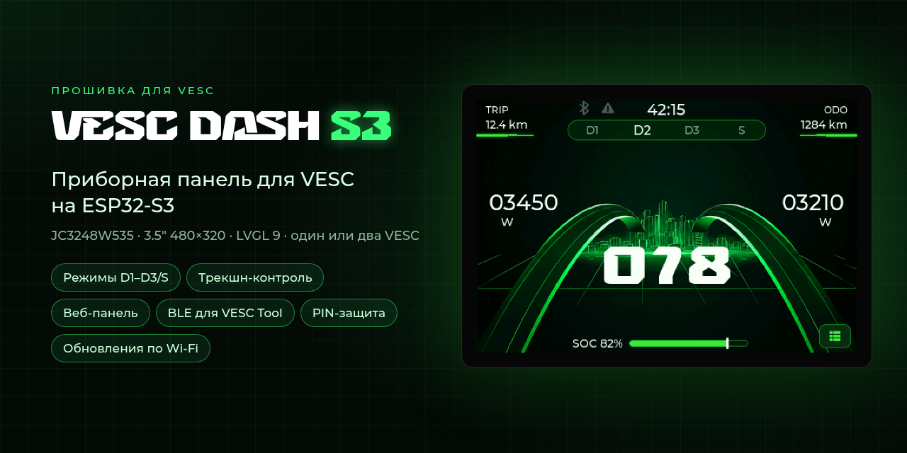
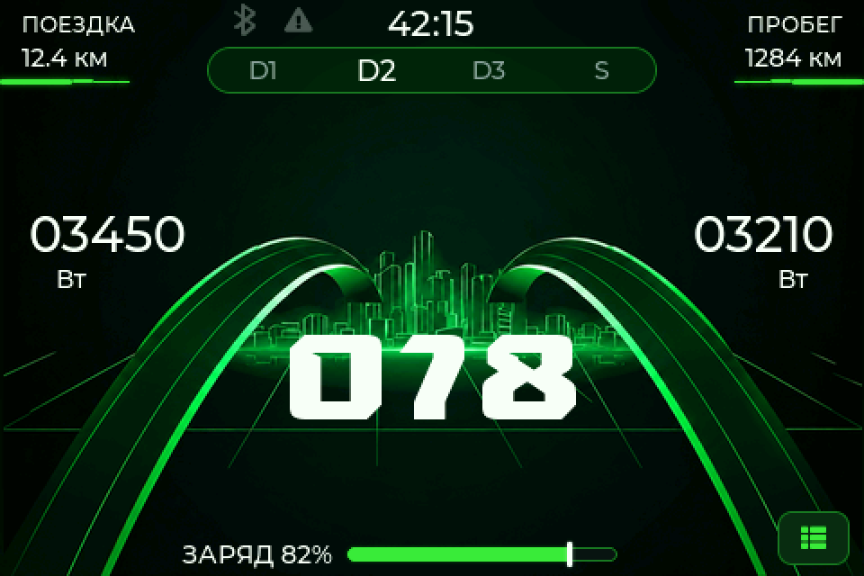
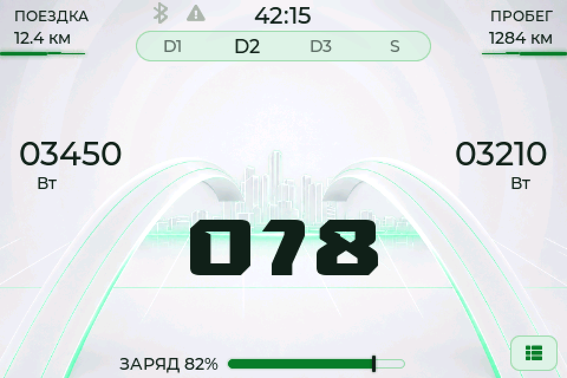
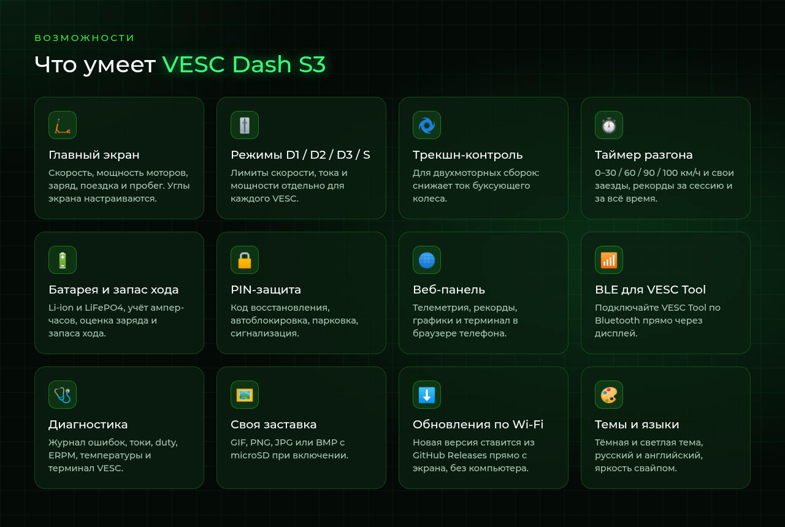
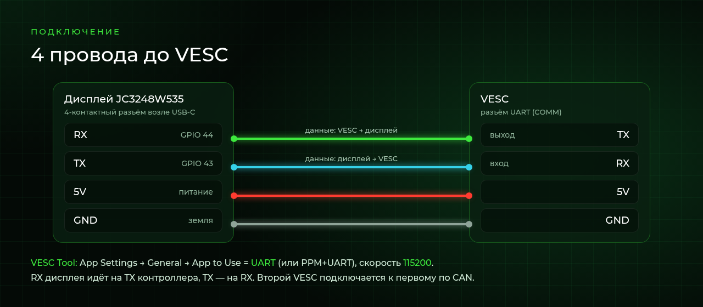

<div align="center">



**Прошивка, которая превращает дисплей JC3248W535 (ESP32-S3, 3.5″ 480×320)<br>в приборную панель самоката или борда на контроллере VESC.**

<sub>Dashboard firmware for VESC-based e-scooters and e-boards · JC3248W535 (ESP32-S3) · RU / EN</sub>

<br>

[](https://github.com/xZeNice/vesc-dash-s3/releases/latest)
[](https://github.com/xZeNice/vesc-dash-s3/releases)


[](https://t.me/doqix)

**[⬇️ Скачать](https://github.com/xZeNice/vesc-dash-s3/releases/latest)** ·
[Установка](#первая-установка) ·
[Настройка](#первая-настройка) ·
[Обновление](#обновление-по-wi-fi) ·
[Вопросы](#частые-вопросы)

</div>

> [!NOTE]
> Здесь публикуются только **готовые файлы прошивки** (в [Releases](https://github.com/xZeNice/vesc-dash-s3/releases)) и документация.
> **Исходный код проекта закрыт и не предоставляется.** Прошивка бесплатна для личного некоммерческого использования — см. [LICENSE](LICENSE).

## Как это выглядит

<p align="center">
  
  
</p>

<p align="center"><sub>Вверху — поездка, пробег, время и режимы D1–D3/S · по бокам — мощность переднего и заднего мотора · в центре — скорость · внизу — заряд и меню</sub></p>

<!-- Сюда можно добавить реальные фото:   -->

## Возможности



### Езда

- **Главный экран** — скорость, мощность каждого мотора, заряд или напряжение батареи, поездка, пробег, время, значки Bluetooth, парковки, перегрева и ошибок. Показатели в верхних углах выбираются в настройках: поездка, пробег, средняя и максимальная скорость, напряжение, токи, энергия, расход, температуры, duty и другие. Касание угла переключает показатель, долгое нажатие сбрасывает поездку.
- **Режимы D1 / D2 / D3 / S** — лимит скорости, % тока мотора, лимиты тока и мощности батареи, отдельно для 1-го и 2-го VESC. Переключаются касанием по полоске вверху экрана, по кнопке сохраняются в контроллер.
- **Трекшн-контроль** для двухмоторных сборок — сравнивает скорости колёс и уменьшает ток мотору буксующего колеса. Работает только на тягу, торможение не трогает.
- **Таймер разгона** — 0–30, 0–60, 0–90, 0–100 км/ч и свои заезды, рекорды за сессию и за всё время.
- **Блокировка касаний на ходу** — выше заданной скорости (по умолчанию 5 км/ч) экран не реагирует на нажатия.
- **Предупреждения о перегреве** мотора и контроллера по своим порогам.

### Батарея

- Li-ion (NMC/NCA) и LiFePO4, число ячеек S и ёмкость батареи.
- Заряд считается по ампер-часам VESC с учётом рекуперации; при ёмкости `0` — по напряжению. Два VESC — одна общая батарея.
- Остаток А·ч и Вт·ч, запас хода и средний расход — в **Статистика → Поездка**.
- Калибровка напряжения по мультиметру.

### Защита

- **PIN-код** с одноразовым кодом восстановления и растущей задержкой после неверных попыток.
- **Авто-блокировка и авто-парковка** по бездействию: в парковке газ заблокирован, на экране — кнопка **P**.
- **Сигнализация** — писк моторами, если заблокированный самокат пытаются катить.
- **Контроль доступа** — сами выбираете, какие экраны и действия требуют PIN.
- Веб-панель защищена паролем; пока экран заблокирован, она работает только на просмотр.

### Веб-панель в телефоне

Дисплей раздаёт свою Wi-Fi сеть `VESC-Dash` (или подключается к домашней), панель открывается в браузере по адресу `http://192.168.4.1`. Пароль показан на экране.

- **Поездка** — спидометр с кольцом мощности, режимы, батарея, дистанция, средняя и максимальная скорость, расход Вт·ч/км, температуры, токи, распределение мощности перед/зад.
- **Рекорды** — пики поездки, рекорды за всё время и каждый заезд разгона с графиком скорости.
- **Медиа** — загрузка и удаление картинок заставки.
- **Сервис** — оба контроллера (ошибки, прошивка, токи, температуры), живой график за 60 секунд и терминал.
- Тёмная, светлая или автоматическая тема, русский и английский.

### Сервис и прочее

- **BLE-мост для VESC Tool** — VESC Tool с телефона подключается по Bluetooth через дисплей (имя `VESC-Dash`). Пока мост работает, телеметрия, лимиты и трекшн-контроль на паузе.
- **Диагностика** — токи, duty, ERPM, рекуперация, версии прошивок VESC, журнал ошибок, данные второго контроллера.
- **Терминал VESC** — на экране (с клавиатурой) и в веб-панели.
- **Своя заставка** при включении — GIF до 7,5 МБ или PNG/JPG/BMP до 5 МБ с microSD, лучше ровно 480×320. GIF копируется во внутреннюю память и дальше играет без карты.
- **Обновления по Wi-Fi** — дисплей сам находит новую версию в Releases этого репозитория и ставит её по кнопке. Настройки и пробег сохраняются.
- **Оформление** — тёмная и светлая темы, русский и английский, единицы скорости, расстояния и температуры, яркость свайпом вверх/вниз, затемнение и сон.

> [!WARNING]
> Лимиты, трекшн-контроль и блокировки — вспомогательные функции, а не системы безопасности. Проверьте настройки на месте, прежде чем ехать.

## Что нужно

| | |
|---|---|
| Дисплей | **JC3248W535** — ESP32-S3 (16 МБ flash, 8 МБ PSRAM), 3.5″ IPS 480×320, ёмкостный тач |
| Контроллер | VESC с прошивкой **5.02 или новее**, один или два (второй — через CAN) |
| microSD | по желанию — для своей заставки |
| Для установки | компьютер с Chrome или Edge и USB-C кабель **с передачей данных** |

## Подключение



| Дисплей (4-контактный разъём у USB-C) | VESC (UART) |
|---|---|
| RX · GPIO 44 | TX |
| TX · GPIO 43 | RX |
| 5V | 5V |
| GND | GND |

Линии данных **перекрещиваются**: RX дисплея — на TX контроллера, TX — на RX. Второй VESC подключается к первому по CAN.

## Первая установка

Делается один раз, по USB, прямо из браузера — ничего устанавливать не нужно. Дальше прошивка обновляется по Wi-Fi.

1. **Скачайте прошивку.** Откройте [последний релиз](https://github.com/xZeNice/vesc-dash-s3/releases/latest) → внизу, в разделе **Assets**, скачайте **`vesc-cyd.ino.merged.bin`**. Нужен именно файл с `merged` в имени: в нём загрузчик, таблица разделов и сама прошивка.
2. **Отключите дисплей от VESC** (или выключите VESC), чтобы питание шло только от USB.
3. **Подключите дисплей к компьютеру** кабелем USB-C.
4. **Откройте прошивальщик:** <https://espressif.github.io/esptool-js/> — в **Chrome** или **Edge** на компьютере (Firefox и Safari не умеют работать с USB-портами).
5. **Подключитесь к плате.** В блоке **Program**: Baudrate оставьте `921600` → **Connect** → в окне выберите порт платы (`USB JTAG/serial debug unit`, `ESP32-S3` или `USB Serial Device (COMx)`) → **Подключиться**. В журнале должно появиться `Chip is ESP32-S3`.
   - Порта нет или подключение не удаётся: зажмите на плате **BOOT**, коротко нажмите **RST** (или переподключите USB, не отпуская BOOT), отпустите BOOT и снова нажмите **Connect**.
6. **Очистите память:** нажмите **Erase Flash** и дождитесь сообщения об успешной очистке (до минуты). При первой установке это обязательно.
7. **Выберите файл:** в строке **Flash Address** впишите **`0x0`** (по умолчанию там `0x1000` — для ESP32-S3 это неправильно), нажмите **Выберите файл** и укажите `vesc-cyd.ino.merged.bin`.
8. **Прошейте:** нажмите **Program** и дождитесь 100 % (около минуты). Не отключайте кабель.
9. **Перезапустите:** нажмите **Disconnect**, затем **RST** на плате или переподключите USB. Дисплей включится и покажет главный экран; надпись «НЕТ ДАННЫХ» — нормально, пока не подключён VESC.

<details>
<summary><b>Через командную строку (esptool)</b></summary>

```bash
pip install esptool
python -m esptool --chip esp32s3 erase_flash
python -m esptool --chip esp32s3 --baud 921600 write_flash 0x0 vesc-cyd.ino.merged.bin
```

Порт определяется сам; если нет — добавьте `--port COM5` (Windows) или `--port /dev/ttyACM0` (Linux).

</details>

## Первая настройка

1. **VESC Tool** (подключите VESC по USB или Bluetooth):
   - **App Settings → General → App to Use** = `UART`. Если газ подключён к VESC через ADC — `ADC and UART`, через PPM — `PPM and UART`.
   - **App Settings → UART → Baudrate** = `115200`.
   - Нажмите **Write App Configuration**.
2. **Подключите дисплей к VESC** по схеме выше и включите питание. Через пару секунд должны появиться данные.
3. На дисплее **≡ → Настройки → Система**:
   - **Трансмиссия** — диаметр колеса, полюса мотора и передаточное число. Без этого скорость и пробег будут неверными.
   - **Батарея** — тип (Li-ion или LiFePO4), число ячеек S и ёмкость всей батареи в А·ч (`0` — заряд только по напряжению).
   - **2-й VESC (CAN)** — если моторов два: CAN ID второго контроллера (`0` — второго нет).
4. **≡ → Настройки → Езда → Режимы езды** — лимиты для D1, D2, D3 и S.
5. По желанию: **Защита** — PIN-код. Запишите код восстановления, который покажет дисплей.

## Обновление по Wi-Fi

1. **≡ → Подключение** → задайте **Имя сети** и **Пароль Wi-Fi** — домашней сети или точки доступа телефона (2,4 ГГц, с интернетом).
2. На этом же экране нажмите значок **⬇** вверху справа (если задан PIN — введите его). Дисплей сам проверит, есть ли новая версия; повторить — кнопка **Проверить**.
3. Если появилось «Доступно обновление» — нажмите **Установить**. Не выключайте питание: после «Обновление завершено» дисплей перезагрузится сам.

- Настройки и пробег сохраняются.
- Если новая версия не запустится, дисплей сам вернётся на предыдущую.
- Поставить более старую версию по Wi-Fi нельзя — это защита от несовместимых настроек и PIN. Старую версию можно поставить только по USB, как при первой установке; настройки и пробег при этом сотрутся.
- «Недавно проверяли — подождите» — повторите через минуту.

## Совместимость с VESC

| Прошивка VESC | Что работает |
|---|---|
| **5.02 и новее** | всё: режимы, трекшн-контроль, PIN-блокировка газа, телеметрия |
| ниже 5.02 | только телеметрия и терминал; PIN блокирует сам экран |
| **6.00+** с LispBM | дополнительно — писк моторами (сигнализация, выбор мотора) |

## Частые вопросы

<details>
<summary><b>На экране «НЕТ ДАННЫХ»</b></summary>

Поменяйте местами провода RX и TX. Проверьте в VESC Tool: **App to Use** с UART, скорость 115200, конфигурация записана. Земля (GND) должна быть общей.
</details>

<details>
<summary><b>Неправильная скорость или пробег</b></summary>

**Настройки → Система → Трансмиссия**: диаметр колеса, число полюсов мотора и передаточное число.
</details>

<details>
<summary><b>Прошивальщик не видит дисплей</b></summary>

Возьмите другой кабель — многие кабели USB-C только заряжают. Закройте программы, которые могут занимать порт (VESC Tool, Arduino IDE, монитор порта). Используйте Chrome или Edge. Не помогло — войдите в режим загрузки: зажмите **BOOT**, нажмите **RST**, отпустите **BOOT**.
</details>

<details>
<summary><b>После прошивки чёрный экран или перезагрузки</b></summary>

Повторите установку: сначала **Erase Flash**, затем файл `vesc-cyd.ino.merged.bin` по адресу **0x0**.
</details>

<details>
<summary><b>Забыл PIN-код</b></summary>

Введите код восстановления. Если его нет — переустановите прошивку по USB с **Erase Flash**: все настройки и пробег сотрутся.
</details>

<details>
<summary><b>Не находит обновление</b></summary>

Нужна сеть Wi-Fi 2,4 ГГц с выходом в интернет. Если написано «Установлена последняя версия» — обновлений пока нет.
</details>

<details>
<summary><b>Подойдёт ли другой дисплей?</b></summary>

Нет, прошивка сделана только для JC3248W535.
</details>

## Лицензия

Бесплатно для личного некоммерческого использования. Нельзя продавать прошивку или устройства с ней, выкладывать файлы прошивки на других ресурсах (делитесь ссылкой на этот репозиторий), изменять и декомпилировать её. Прошивка предоставляется «как есть», используете на свой риск. Полный текст — [LICENSE](LICENSE).

## Автор

**xZeNice** · Telegram [@doqix](https://t.me/doqix) — вопросы, ошибки и предложения.

Если прошивка пригодилась, поддержать автора можно через QR-код в **Настройки → О программе**.
